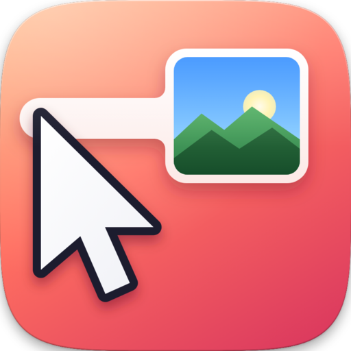
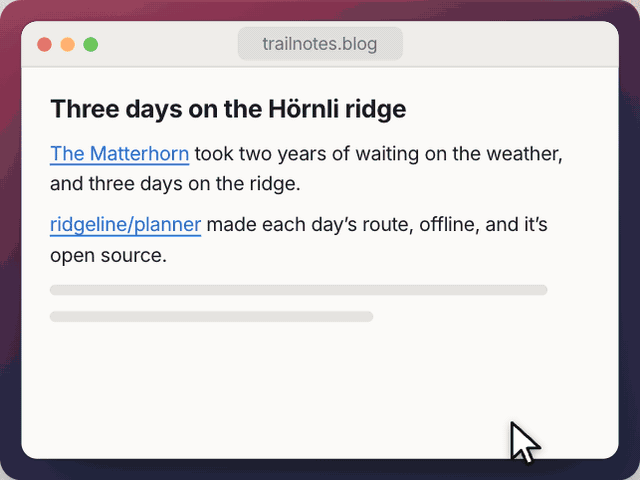
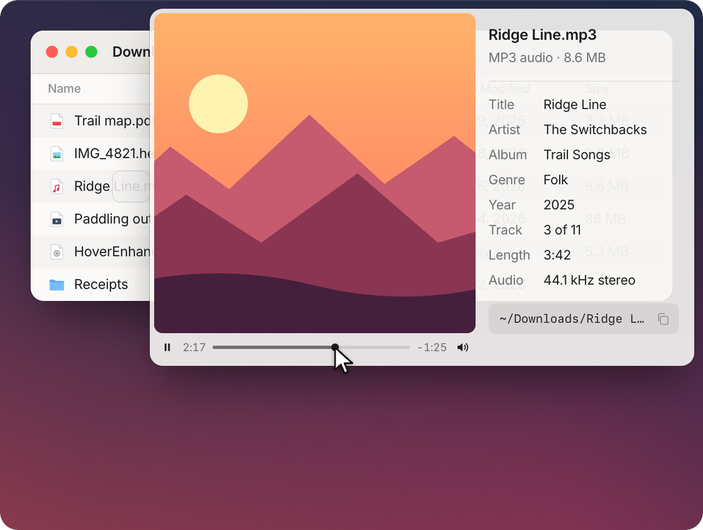
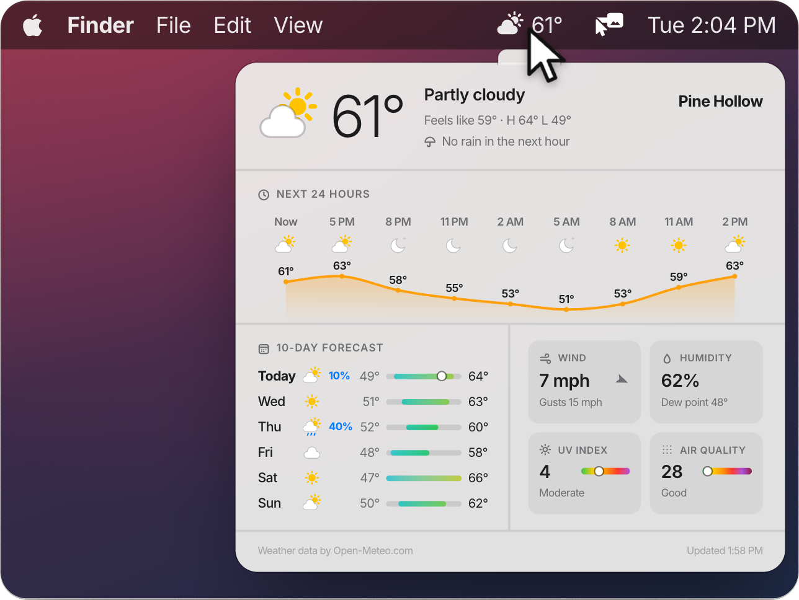
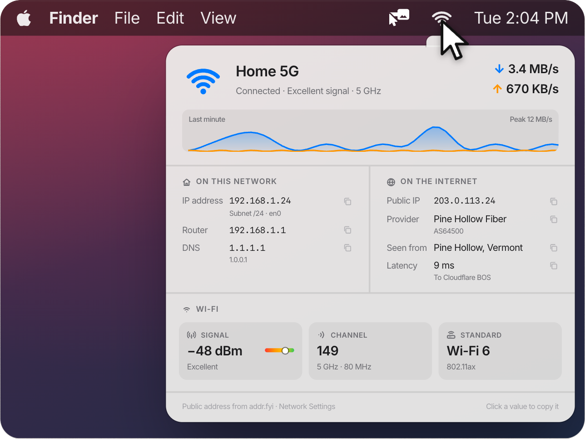

  

<h1 align="center">HoverEnhance</h1>

  <strong>Hover to zoom or inspect. No browser extension.</strong> 
  Rest your cursor on an image, video, or file and see it right there: full-size images and videos
  in your browser, large previews and file details in Finder, and more from the menu bar.

  
  
  
  

  <a href="https://github.com/jstilwell/HoverEnhance/releases/latest"><strong>Download</strong></a> ·
  <a href="https://hoverenhance.com">Website</a> ·
  <a href="CHANGELOG.md">Changelog</a>

  

## In your browser

- **Images**: rest on a thumbnail or an image link and the full-size image appears. Scroll to zoom.
- **Albums**: Reddit galleries and multi-photo posts on X, Bluesky, and Instagram, in its feed too,
  from the photo you're on. Scroll to step through. Immune to smooth-scrolling glitches.
- **Videos**: Reddit, X, Bluesky, Instagram, Streamable, Imgur, and RedGIFs clips play in the
  preview; YouTube, Vimeo, TikTok, and Twitch play in their own players. Scroll on the notch under the
  cursor for the volume, shown beside it, and on the video to move through it.
- **YouTube cards**: on YouTube, rest on a video title for its length, views, likes, date, and who
  made it, or on a channel name for the channel's banner and numbers.

Images the page already shows large are left alone unless their post has more photos, as are videos
it's already playing. Move away, click, press Esc, or switch apps or Spaces, and the preview is gone.

## In Finder

Rest on a file or folder for its path, size, dates, where it came from, and which apps are using it.

- **Images, songs, and videos** show large beside their details, including what songs' and videos'
  own tags say.
- **Play, mute, and scrub** songs and videos, with the time under them.
- **Click any detail** to copy it.

 

## In the menu bar

<table>
  <tr>
    <td width="50%"></td>
    <td width="50%"></td>
  </tr>
  <tr>
    <td valign="top">
      <strong>Weather</strong>: rest on the Weather item for the forecast it doesn't show: the next 24
      hours, ten days, wind, humidity, pressure, UV, air quality, sun and moon, and alerts.
    </td>
    <td valign="top">
      <strong>Network</strong>: rest on the Wi-Fi item for the connection, live download and upload
      speeds, local and public IP addresses, router, DNS, provider, latency, and the Wi-Fi signal,
      channel, and security. Click any of it to copy it.
    </td>
  </tr>
</table>

Weather comes from Open-Meteo by default, or OpenWeatherMap, WeatherAPI.com, Tomorrow.io, Pirate
Weather, or AccuWeather with your own key. AccuWeather adds pollen, the temperature in the shade, the
change since yesterday, and a forecaster's summary; its key needs a paid plan after a 14-day trial.

## Install

1. Download the latest DMG from [Releases](https://github.com/jstilwell/HoverEnhance/releases/latest).
2. Open it and drag HoverEnhance to Applications.
3. Follow the welcome window to turn on Accessibility access, which lets HoverEnhance see what's
   under the cursor: it adds HoverEnhance to the list, and you switch it on.

Requires macOS 14 or later. Signed, notarized, and updates itself.

## Privacy

- **Only what you hover**: HoverEnhance reads the thing under the cursor, never what you type.
- **Only where you point**: it contacts the sites behind what you hover, GitHub to check for
  updates, addr.fyi for the network popup's public address, and Google only if you sign in to
  subscribe to YouTube channels.
- **Not your network**: links and images on a web page that point at your router, printer, or
  anything else on your local network are left alone.
- **No tracking cookies**: images from anywhere but the sites under Settings → Sites load without
  cookies, so they can't follow you from site to site.
- **Weather where you say**: nothing is looked up until you pick a place or allow your location,
  which goes to the weather provider you choose rounded to about a kilometer (and, in the US, to the
  National Weather Service for alerts when your provider has none, unless you turn that off).
- **Network from the Mac**: the network popup reads everything from your Mac except the public IP
  address, which comes from [addr.fyi](https://addr.fyi), also run by HoverEnhance's maintainer (it
  sees only that address; turn it off in Settings).
- **Browsers by default**: links in other apps, like Mail, load nothing unless you allow it in
  Settings.
- **Not your email**: no previews on webmail, like Gmail or Outlook, where a link can tell its sender
  you read the message. Settings can turn them back on.
- **No surprise downloads**: images over 25 MB (adjustable) wait for you to click Load Anyway, and
  files only in iCloud stay there.

## Settings

From the menu bar icon:

- **General**: a shortcut that pauses previews from any app, when they appear (always, or while
  holding a key), the hover delay, links in other apps, and apps to skip.
- **Previews and Video**: what to preview, the largest image to download, the notch, scrolling, and
  playback.
- **Sites**: websites to skip, webmail included by default; the menu can also skip the one you're on.
- **Finder**: what file cards show, and when.
- **Weather**: the provider, place, and units.
- **macOS**: the network popup and its public IP lookup.
- **Accounts**: sign in to YouTube to subscribe from its cards.

## Building from source

`./bin/run.sh` builds and launches it (requires Xcode). See [docs/DEVELOPMENT.md](docs/DEVELOPMENT.md)
for tests, releases, and how it works.

## License

[MIT](LICENSE). Includes [Sparkle](https://github.com/sparkle-project/Sparkle) for updates, under its
own MIT license.
